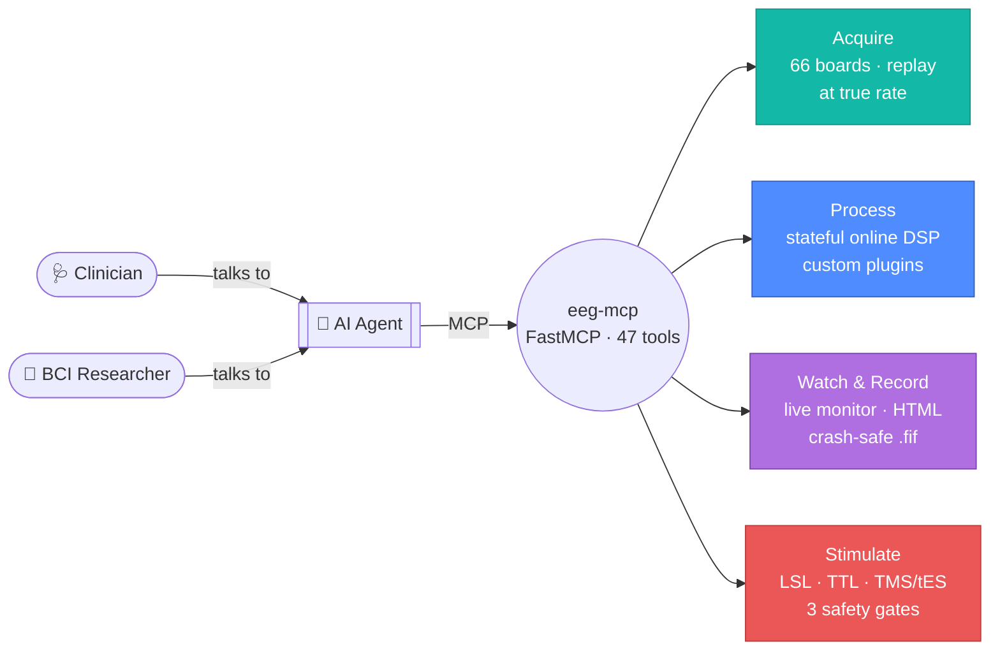
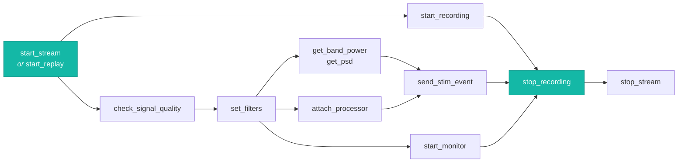
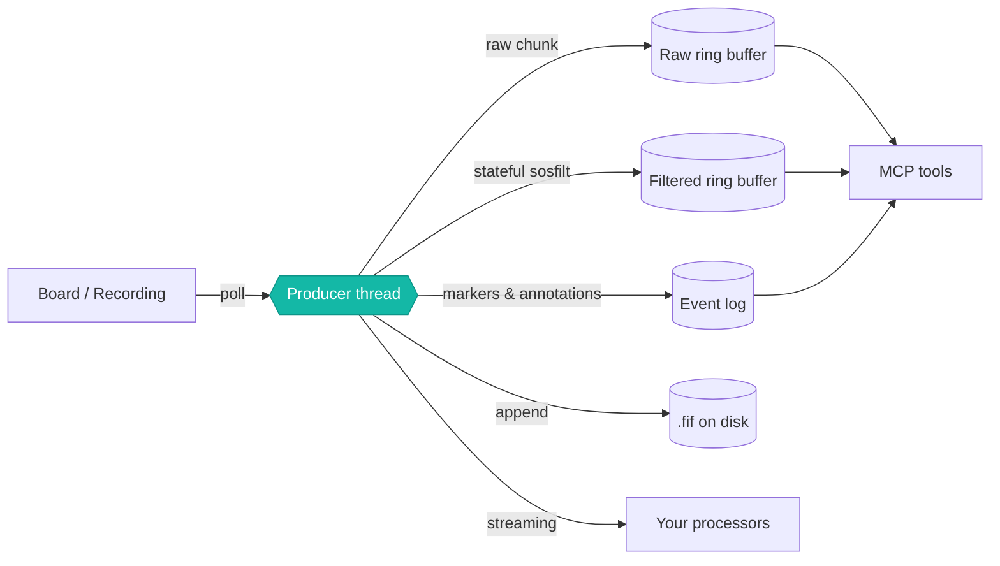

<!-- mcp-name: io.github.AImplifier/eeg-mcp -->

<div align="center">

# ⚡🧠 eeg-mcp

### Real-time EEG for AI agents — stream, replay, visualize, record, stimulate

[](https://pypi.org/project/eeg-mcp/)
[](https://pypi.org/project/eeg-mcp/)
[](https://aimplifier.github.io/eeg-mcp/)
[](LICENSE)

**[Documentation](https://aimplifier.github.io/eeg-mcp/)** ·
**[Tutorial](https://aimplifier.github.io/eeg-mcp/examples/tutorial-first-realtime-session/)** ·
**[Hardware](https://aimplifier.github.io/eeg-mcp/hardware/)** ·
**[Safety](https://aimplifier.github.io/eeg-mcp/safety/)** ·
**[Tool Reference](https://aimplifier.github.io/eeg-mcp/tools/)**

</div>

A Model Context Protocol server that gives an AI agent one interface over the
**live** EEG workflow: acquisition from ~66 [BrainFlow](https://brainflow.readthedocs.io)
boards, wall-clock replay of existing recordings, stateful online DSP, a live
browser monitor, crash-safe recording, and gated stimulation output.

The offline counterpart is **[neuro-mcp](https://github.com/AImplifier/neuro-mcp)**
(MNE processing, source imaging, BIDS/EHR storage). This is the real-time half —
everything that has to happen while the signal is still arriving.

## Concept



Nobody calls a tool by hand — you talk to an agent in plain English and it
drives the 47 tools underneath. The
**[tutorial](https://aimplifier.github.io/eeg-mcp/examples/tutorial-first-realtime-session/)**
shows what that looks like end to end, with no hardware required.

## What it does

<table>
<tr>
<td width="50%" valign="top">

**📡 Stream**

66 BrainFlow board identifiers — OpenBCI, Muse, ANT Neuro, g.tec, Mentalab and
more — plus a synthetic board that needs no hardware. Samples land in a ring
buffer filled by a background thread, so tool calls read a live view instead of
blocking on a device.

</td>
<td width="50%" valign="top">

**⏪ Replay**

Play an EDF/BDF/GDF/SET/FIF or BrainFlow CSV *at the rate it was recorded*,
re-emitting annotations as events at their original timings. Adds speed, seek,
pause and looping. A pipeline developed against a file runs **unchanged**
against hardware.

</td>
</tr>
<tr>
<td width="50%" valign="top">

**👁 Visualize**

A loopback-bound, token-gated live browser view: rolling traces, event markers,
band power, per-electrode quality, and transport controls. Plus self-contained
HTML reports — no CDN, no external assets, opens on an air-gapped machine.

</td>
<td width="50%" valign="top">

**💾 Record**

Write continuously to MNE-native `.fif` with the event log attached as
annotations, plus a metadata row in a store **schema-compatible with
neuro-mcp**. Crash-safe: an interrupted session is recoverable.

</td>
</tr>
<tr>
<td width="50%" valign="top">

**🧩 Extend**

Plug in your own real-time processor — feature extractor, classifier, artifact
gate, or **EEG tokenizer for sequence models** — and it runs on the same footing
as the built-ins, inside the acquisition loop.
→ [Extending](https://aimplifier.github.io/eeg-mcp/extending/)

</td>
<td width="50%" valign="top">

**⚡ Stimulate**

One `send_stim_event` contract over pluggable backends: LSL for software,
BrainFlow's marker channel for sample-aligned embedding, serial/TTL and
templated ASCII for hardware including TMS and tES — behind three safety gates.

</td>
</tr>
</table>

> [!NOTE]
> **One event log.** Board markers, replayed annotations, dispatched
> stimulations and manual notes all land in the same table on the same clock, with
> absolute sample indices. A closed-loop run reconstructs afterwards with no clock join.

## Install

```bash
conda create -n eeg-mcp python=3.11 -y && conda activate eeg-mcp
pip install eeg-mcp
```

<details>
<summary><b>Optional extras and MCP client registration</b></summary>

<br>

```bash
pip install "eeg-mcp[lsl]"      # LSL marker outlets (PsychoPy, OpenViBE, ...)
pip install "eeg-mcp[serial]"   # serial/TTL trigger delivery to hardware
```

Register with an MCP client using an **absolute path** to the env's interpreter:

```json
{
  "mcpServers": {
    "eeg-realtime": {
      "command": "/path/to/envs/eeg-mcp/bin/python",
      "args": ["-m", "eeg_mcp"]
    }
  }
}
```

Or with the Claude Code CLI:

```bash
claude mcp add eeg-realtime -- /path/to/envs/eeg-mcp/bin/python -m eeg_mcp
```

→ Full guide: **[Installation](https://aimplifier.github.io/eeg-mcp/installation/)**

</details>

## Quick start

Ask your agent for the outcome; it picks the calls. No hardware required:

```python
start_stream(session_id="s1", board="synthetic")
check_signal_quality(session_id="s1")          # before trusting anything
set_filters(session_id="s1", bandpass_low=1, bandpass_high=40, notch_freq=50)
get_band_power(session_id="s1", seconds=2)
start_monitor(session_id="s1")                 # → open the returned URL
```

Replay a real recording as if it were live, then keep the record:

```python
inspect_recording(path="sub-04_rest.edf")
start_replay(session_id="r1", path="sub-04_rest.edf", speed=1.0)
get_events(session_id="r1", origin="annotation")
export_report(session_id="r1", notes="Routine review.")
```

<div align="center">



</div>

## Documentation

| Guide | |
|---|---|
| 🚀 **[Installation](https://aimplifier.github.io/eeg-mcp/installation/)** | Environment, client registration, troubleshooting |
| 📘 **[Tutorial](https://aimplifier.github.io/eeg-mcp/examples/tutorial-first-realtime-session/)** | End to end, no hardware needed |
| ⏪ [Replay-Driven Development](https://aimplifier.github.io/eeg-mcp/examples/replay-driven-development/) | Build against a recording, deploy live |
| 🔁 [Closed-Loop Neurofeedback](https://aimplifier.github.io/eeg-mcp/examples/closed-loop-neurofeedback/) | Feature → trigger, with a measured latency budget |
| 🩺 [Live Clinical Review](https://aimplifier.github.io/eeg-mcp/examples/clinical-live-review/) | Visual review, annotation, reporting |
| ⚡ [Stimulation Protocols](https://aimplifier.github.io/eeg-mcp/examples/stimulation-protocols/) | TMS and tES through the safety gates |
| 🧩 [Extending](https://aimplifier.github.io/eeg-mcp/extending/) | Write a custom processor or EEG tokenizer |
| 🔌 [Supported Hardware](https://aimplifier.github.io/eeg-mcp/hardware/) | All 66 boards, formats, stimulation transports |
| ⚠️ [Safety](https://aimplifier.github.io/eeg-mcp/safety/) | **Read before connecting a stimulator** |
| 🛠 [Tool Reference](https://aimplifier.github.io/eeg-mcp/tools/) | All 47 tools |

## The one design decision worth knowing

> [!IMPORTANT]
> **Filtering happens in the producer thread, not at query time.**

A stateful IIR filter must see every sample exactly once, in order. The common
shortcut — filtering each query window independently — restarts the filter at
every window boundary and injects a transient each time. It is invisible in a
band-power plot and **fatal for anything phase-sensitive**.

So the producer filters each chunk once as it arrives, carrying `sosfilt`
delay-line state forward, and writes to a second ring buffer. Queries just read.



The test suite asserts chunked filtering matches whole-signal filtering to
**1e-9**, *and* asserts as a control that the naive approach does not.

| Consequence | |
|---|---|
| Filters are **causal** | No zero-phase option — that needs future samples. `stream_status` reports `group_delay_sec` |
| Both buffers are kept | `read_window(filtered=false)` always gets raw signal, to check whether a feature is real or an artifact |
| Indices are shared | An event's `sample_index` means the same thing in either buffer |

> [!TIP]
> Budget a closed loop as **group delay + poll interval + dispatch latency** —
> measured at **~71 ms** in the reference configuration. Good for neurofeedback;
> not adequate for phase-locked stimulation.

## Stimulation safety

> [!CAUTION]
> **This software is not a medical device and has not been validated for
> clinical use.** TMS and tES can cause harm, **including seizure**. Use only
> under a protocol approved by your ethics board, on a rig whose device-level
> interlocks are intact, with a trained operator present.

Three gates apply to every hardware backend:

| # | Gate | Effect |
|---|---|---|
| 1 | **Config** | Hardware backends refuse to open unless the server was started with `EEG_MCP_ALLOW_HARDWARE_STIM=1`. **An agent cannot set this.** |
| 2 | **Arming** | `arm_stim` permits dispatch for a window that *expires*, so a stalled agent cannot resume and fire later |
| 3 | **Limits** | Intensity, duration and interval are clamped; violations **raise** rather than silently saturate |

None of this replaces the interlocks on the device itself.

> [!WARNING]
> **The hardware backends are generic transports driven by command templates you
> supply from your device's manual — not vendor drivers, and none has been tested
> against a physical stimulator.** A plausible-looking untested driver would be
> worse than none: it would fail silently while connected to something pointed at
> a person's head.
>
> Start every protocol on `backend="log"`, which accepts everything and emits nothing.

## Verify

```bash
python testing/verify.py                    # core correctness
python testing/verify_recording.py          # recording + metadata store
python testing/verify_processing.py         # plugin processors
python testing/persona_bci_researcher.py    # engineer workflow
python testing/persona_clinician.py         # clinician workflow
```

All five drive the real server through FastMCP's in-memory client and assert
against **planted ground truth**:

- a spike planted at an annotation onset lands at **t = 0 ± 0 ms** in the
  extracted epoch — proving annotation timing, replay clock, ring-buffer
  indexing and epoch extraction all agree;
- a deliberately **broken plugin cannot stop acquisition** — throughput holds at 1.0;
- hardware stimulation is **refused** while the config gate is unset.

→ **[What is and is not covered](https://aimplifier.github.io/eeg-mcp/testing/)** —
including an honest list of what has never been tested against real hardware.

## License

BSD-3-Clause. See **[LICENSE](LICENSE)** and **[NOTICE](NOTICE)**.

<div align="center">
<br>

**[⬆ back to top](#-eeg-mcp)** · Part of the
**[AImplifier](https://github.com/AImplifier)** neuro toolchain ·
sibling project **[neuro-mcp](https://github.com/AImplifier/neuro-mcp)**

</div>
