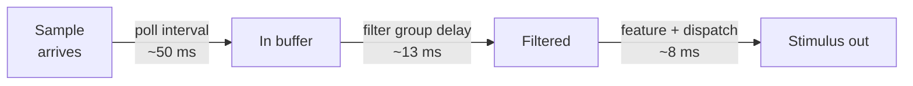
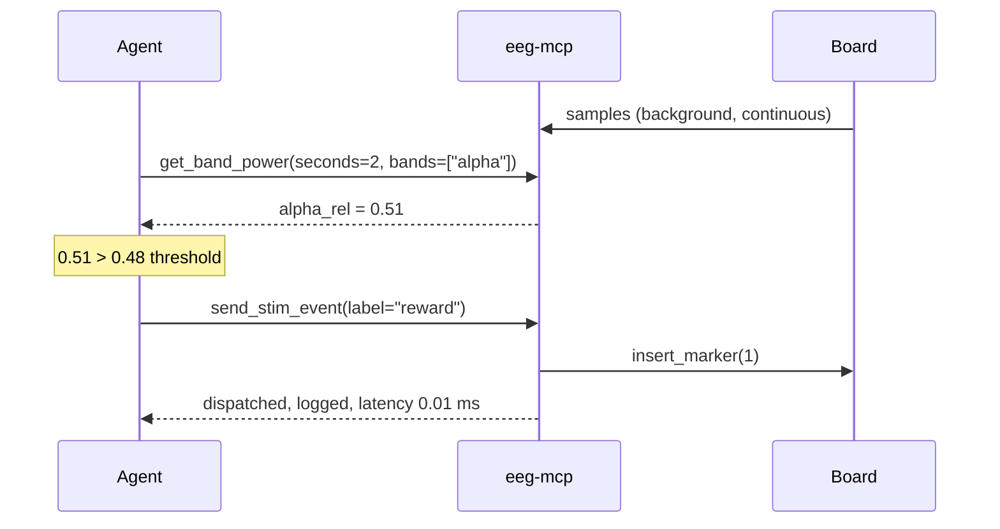

# Closed-Loop Neurofeedback

**The goal.** Read a feature from the live signal, decide, and act — repeatedly,
fast enough that the subject experiences it as contingent on their own brain
activity.

**The thing that decides whether it works.** Your latency budget. Not the
algorithm. This page measures it rather than assuming it.

---

## Step 1 — Know your budget before you build

Three terms, all measurable:



| Term | Where it comes from | Typical | How to reduce it |
|---|---|---|---|
| Poll interval | `EEG_MCP_POLL_INTERVAL_SEC` | 50 ms | Lower to 20 ms |
| Filter group delay | `stream_status` → `filters.group_delay_sec` | 13 ms | Lower filter order, wider band |
| Feature + dispatch | Measured below | 8 ms | Shorter window, fewer channels |

Measured total in the reference configuration: **~71 ms**.

!!! success "What 71 ms is good for"
    Band-power neurofeedback, contingent cues, adaptive task difficulty,
    state-dependent stimulation on a scale of hundreds of milliseconds.

!!! warning "What it is not good for"
    Phase-locked stimulation. Targeting a specific phase of a 10 Hz rhythm needs
    accuracy well under 25 ms, and a **causal** filter's group delay alone
    blows that. Phase-locked work needs forward prediction and a hardware
    trigger path — do not attempt it by polling this API.

## Step 2 — Set up the stream

```text
start_stream(session_id="nfb", board="cyton", params={"serial_port": "COM3"})
check_signal_quality(session_id="nfb")
```

Never skip the quality check on a feedback session. A flat electrode produces a
perfectly stable band-power value that means nothing, and the subject will
happily "train" against noise.

## Step 3 — Filter for the band you are training

For alpha uptraining, filter tightly and check the cost:

```text
set_filters(session_id="nfb", filters=[
  {"kind": "notch",    "low": 50},
  {"kind": "bandpass", "low": 8, "high": 13, "order": 4}
])
```

```json
{"filters": {"n_stages": 2, "group_delay_sec": 0.0412}}
```

!!! tip "Narrow bands cost latency"
    An 8–13 Hz band-pass has ~41 ms group delay; 1–40 Hz has ~13 ms. A tight
    band gives a cleaner feature and a slower loop. Often the better choice is a
    **wide** filter plus `get_band_power`, which does the band separation in the
    frequency domain at no latency cost:

    ```text
    set_filters(session_id="nfb", bandpass_low=1, bandpass_high=40, notch_freq=50)
    get_band_power(session_id="nfb", bands=["alpha"], seconds=2)
    ```

## Step 4 — Establish a baseline

```text
get_band_power(session_id="nfb", seconds=30, channels=["O1", "O2"], relative=true)
```

```json
{"mean_across_channels": {"alpha": 38.4, "alpha_rel": 0.42}, "dominant_band": "alpha"}
```

Use `alpha_rel`, not `alpha`. Relative power is each band as a fraction of the
total, which makes it largely immune to impedance drift — a threshold set on
absolute power will drift out of calibration within the hour as the gel settles.

Set the threshold from the baseline, e.g. `0.42 × 1.15 = 0.48`.

## Step 5 — Run the loop

Attach a target — start with `log` so nothing is delivered:

```text
attach_stim_backend(session_id="nfb", backend="log")
```

Each iteration:

```text
get_band_power(session_id="nfb", seconds=2, channels=["O1","O2"], bands=["alpha"])
```

```json
{"mean_across_channels": {"alpha_rel": 0.51}}
```

Above threshold, so reward:

```text
send_stim_event(session_id="nfb", label="reward", value=1)
```

```json
{"dispatch_latency_ms": 0.012, "marked_in_source": true,
 "event": {"label": "reward", "origin": "stim", "sample_index": 91250}}
```

The reward is now in the same event log as the EEG markers, on the same clock —
so the whole session reconstructs afterwards with no clock join.

### Window length is the responsiveness/stability trade-off

| Window | Feature noise | Responsiveness | Use for |
|---|---|---|---|
| 0.5 s | High | Immediate | Fast contingent feedback |
| 2 s | Moderate | ~2 s smoothing | **Default** for band-power feedback |
| 5 s+ | Low | Sluggish | Slow state tracking, drowsiness |

Windows overlap, so a 2 s window queried every 250 ms gives smooth updates with
2 s of averaging.

## Step 6 — Guard against runaway loops

An agent-driven loop can fire far faster than intended. Two defences:

**Server-side** — an interval floor that raises rather than silently dropping:

```json
"env": { "EEG_MCP_MIN_STIM_INTERVAL_MS": "500" }
```

```text
SafetyError: Only 120.4 ms since the last stimulation; the minimum safe
interval is 500.0 ms.
```

**In the loop** — check `stream_status` periodically:

```json
{"throughput_ratio": 0.71, "last_error": null}
```

Below 1.0 means the producer is not keeping up and samples are being dropped —
your feature is computed on incomplete data. Stop and fix that before trusting
anything.

## Step 7 — Watch it while it runs

```text
start_monitor(session_id="nfb", window_sec=10)
```

Every reward appears as a vertical line on the traces, live. It is the fastest
way to catch a loop that is firing on an artifact rather than on alpha.

## Step 8 — Keep the record

```text
export_report(session_id="nfb", seconds=20,
              notes="Alpha uptraining, O1/O2, threshold 0.48 rel.")
get_events(session_id="nfb", origin="stim")
```

---

## Full loop, condensed



## Common mistakes

| Mistake | Symptom | Fix |
|---|---|---|
| Thresholding absolute power | Works for 20 min, then drifts | Use `*_rel` values |
| Filtering to the target band only | Loop feels laggy | Wide filter + `get_band_power` band selection |
| Skipping the quality check | Subject trains against a dead electrode | `check_signal_quality` first, and re-check periodically |
| Ignoring `throughput_ratio` | Features computed on gappy data | Poll `stream_status`; treat < 1.0 as a stop condition |
| Assuming dispatch latency is the whole budget | Feedback feels late | Add poll interval + group delay |
| Attempting phase-locking by polling | Phase is effectively random | Use a hardware trigger path instead |
