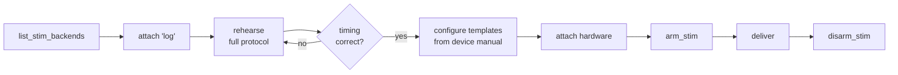

# Stimulation Protocols (TMS / tES)

!!! danger "Before you read further"
    Transcranial stimulation can cause harm, including seizure. Use only under a
    protocol approved by your ethics board, on a rig whose device-level
    interlocks are intact, with a trained operator present who can stop
    stimulation. **eeg-mcp is not a medical device**, and its hardware backends
    are generic transports you configure — not validated vendor drivers.

    Read [Safety](../safety.md) in full first.

---

## The shape of every protocol



Steps 1–4 involve no device and no risk. Do all of them before step 5.

## Step 1 — See what is available

```text
list_stim_backends()
```

```json
{
  "hardware_enabled": false,
  "limits": {"max_intensity": 100.0, "max_duration_ms": 10000.0,
             "min_interval_ms": 0.0},
  "backends": [
    {"name": "log", "is_hardware": false, "available": true},
    {"name": "lsl", "is_hardware": false, "available": true},
    {"name": "tms", "is_hardware": true, "available": false,
     "blocked_reason": "EEG_MCP_ALLOW_HARDWARE_STIM is not set"},
    {"name": "tes", "is_hardware": true, "available": false,
     "blocked_reason": "EEG_MCP_ALLOW_HARDWARE_STIM is not set"}
  ]
}
```

`hardware_enabled: false` is the default and is correct until an operator
deliberately changes it in the **server's** environment.

## Step 2 — Rehearse the whole protocol on `log`

```text
attach_stim_backend(session_id="s1", backend="log")
```

The `log` backend accepts every command and emits nothing. This is not a
placeholder — it is how you validate timing, event logging, and your own loop
logic with zero risk.

A 10 Hz rTMS train, 20 pulses:

```text
send_stim_train(session_id="s1", label="rtms_10hz", n_pulses=20, interval_ms=100)
```

```json
{
  "n_delivered": 20,
  "requested_interval_ms": 100.0,
  "realised_interval_ms": {"mean": 100.02, "min": 97.16, "max": 103.20},
  "total_sec": 1.900
}
```

Read those *realised* numbers carefully. Mean is accurate and there is no
cumulative drift — pulses are scheduled against the train's start, not the
previous pulse — but individual gaps vary by a few milliseconds.

!!! warning "Python is not a real-time system"
    A few ms of jitter is fine for cues and for tES ramps. It is **not** adequate
    for sub-millisecond rTMS timing. For that, program the train into the
    stimulator's own sequencer and use eeg-mcp to arm, gate, and record it.

## Step 3 — Get the command strings from your device manual

The hardware backends send what you tell them to. Templates are filled with
`str.format` from the command's fields, so `{intensity}`, `{value}`,
`{duration_ms}`, `{label}` and anything in `params` are available.

Placeholders are substituted textually — there is no expression evaluation, so a
template cannot execute code.

## Step 4 — Enable hardware in the server config

This is an operator action, in the MCP client config — not something an agent can do:

```json
{
  "mcpServers": {
    "eeg-realtime": {
      "command": "/path/to/envs/eeg-mcp/bin/python",
      "args": ["-m", "eeg_mcp"],
      "env": {
        "EEG_MCP_ALLOW_HARDWARE_STIM": "1",
        "EEG_MCP_SERIAL_PORT": "COM3",
        "EEG_MCP_MAX_STIM_INTENSITY": "60",
        "EEG_MCP_MIN_STIM_INTERVAL_MS": "95"
      }
    }
  }
}
```

Set the ceilings to **your protocol's approved limits**, not to the defaults.
The interval floor is what prevents a miscalculated loop turning a 10 Hz train
into a 100 Hz one.

---

## rTMS example

### Attach

```text
attach_stim_backend(session_id="s1", backend="tms", options={
  "port": "COM3",
  "templates": {
    "set_intensity": "AMP {intensity:.0f}\r\n",
    "fire":  "TRIG\r\n",
    "pulse": "TRIG\r\n"
  },
  "read_reply": true
})
```

```json
{
  "attached": "tms",
  "status": {"open": true, "armed": false, "is_hardware": true,
             "capabilities": {"intensity_unit": "%MSO"}},
  "next": "Call arm_stim before sending -- this backend drives hardware."
}
```

Attaching opens the port. It does **not** permit stimulation.

### Arm

```text
arm_stim(session_id="s1", backend="tms", ttl_sec=120)
```

```json
{"armed": true, "expires_in_sec": 120.0}
```

Keep the window as short as the block. Arming expires so a stalled agent cannot
resume and fire minutes later on a stale decision.

### Deliver

Single pulse at 60% MSO:

```text
send_stim_event(session_id="s1", label="tms_single", value=1,
                kind="pulse", intensity=60, unit="%MSO", target="M1_left")
```

```json
{
  "backend": "tms",
  "is_hardware": true,
  "dispatch_latency_ms": 4.21,
  "detail": {"delivered": true,
             "commands_sent": ["AMP 60\r\n", "TRIG\r\n"]},
  "event": {"label": "tms_single", "origin": "stim"}
}
```

Intensity is set *before* firing — the ordering every stimulator protocol
assumes, and the one that fails safe if the second step errors.

A 10 Hz train:

```text
send_stim_train(session_id="s1", label="rtms_10hz", n_pulses=20,
                interval_ms=100, intensity=60)
```

### Disarm the moment the block ends

```text
disarm_stim(session_id="s1", backend="tms")
```

---

## tES example

tES differs in that current is *ramped* and held for minutes rather than pulsed.

```text
attach_stim_backend(session_id="s1", backend="tes", options={
  "port": "COM4",
  "max_current_ma": 2.0,
  "templates": {
    "ramp":   "RAMP {intensity:.2f} {duration_ms:.0f}\r\n",
    "fire":   "START {intensity:.2f}\r\n",
    "custom": "STOP\r\n"
  }
})
```

Note `max_current_ma: 2.0` — set to the protocol's approved current, below the
backend's own 4 mA default ceiling.

```text
arm_stim(session_id="s1", backend="tes", ttl_sec=1500)

send_stim_event(session_id="s1", label="tdcs_ramp_up", kind="ramp",
                intensity=2.0, unit="mA", duration_ms=30000,
                target="F3_anodal")
```

Long durations need the duration ceiling raised deliberately:

```json
"env": { "EEG_MCP_MAX_STIM_DURATION_MS": "1200000" }
```

Stop:

```text
send_stim_event(session_id="s1", label="tdcs_stop", kind="custom", intensity=0)
disarm_stim(session_id="s1", backend="tes")
```

---

## Software targets

Often you want to mark, not stimulate.

### LSL — reach other software

```text
attach_stim_backend(session_id="s1", backend="lsl",
                    options={"stream_name": "experiment-markers"})
send_stim_event(session_id="s1", label="cue_left", value=3)
```

PsychoPy, OpenViBE, LabRecorder and any other LSL client on the machine sees the
marker and timestamps it against their own streams. Needs `pip install
"eeg-mcp[lsl]"`.

### BrainFlow marker channel — sample-aligned

```text
attach_stim_backend(session_id="s1", backend="brainflow_marker")
```

The highest-fidelity option: BrainFlow interleaves the marker with the samples
itself, so no clock join is ever needed. Requires a live BrainFlow stream.

### Serial TTL — trigger boxes

```text
attach_stim_backend(session_id="s1", backend="serial_ttl",
                    options={"port": "COM5", "pulse_ms": 10})
send_stim_event(session_id="s1", label="trigger", value=64, kind="pulse")
```

Writes the code, holds it for `pulse_ms`, then writes zero — the convention for
boxes that latch until cleared.

---

## What gets recorded, always

Every command is logged as an event **whether or not the transport succeeded**:

```text
get_events(session_id="s1", origin="stim")
```

```json
{
  "events": [
    {"label": "tms_single", "origin": "stim", "value": 1.0,
     "sample_index": 128400,
     "payload": {"backend": "tms", "delivered": true, "marked_in_source": true,
                 "commands_sent": ["AMP 60\r\n", "TRIG\r\n"]}},
    {"label": "tms_single", "origin": "stim",
     "payload": {"backend": "tms", "delivered": false,
                 "error": "Only 42.1 ms since the last stimulation; the minimum
                           safe interval is 95.0 ms."}}
  ]
}
```

A refused stimulation is as much a part of the record as a delivered one. Combined
with the EEG on the same clock, the session reconstructs completely.

## Troubleshooting

| Error | Meaning | Fix |
|---|---|---|
| `Backend 'tms' ... is disabled` | Config gate | Operator sets `EEG_MCP_ALLOW_HARDWARE_STIM=1` |
| `not armed (or arming expired)` | Arm gate | `arm_stim` again |
| `intensity=85 exceeds the configured ceiling` | Limit gate | Check the protocol; raise the ceiling only if genuinely required |
| `Only 42.1 ms since the last stimulation` | Interval floor | Your loop is firing too fast |
| `No 'fire' template configured` | Missing template | Add it from the device manual |
| `Template 'fire' references 'freq'` | Unknown placeholder | Pass it via `params={"freq": 10}` |
