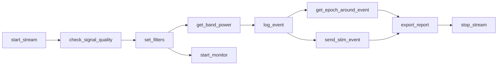

# Tutorial: Your First Real-Time Session

A complete walkthrough, start to finish, with **no hardware required**. By the
end you will have streamed a live signal, filtered it correctly, watched it in a
browser, marked events, and produced a report you can keep.

Everything here uses the synthetic board, so you can follow along on a laptop.

---

## Step 1 — See what you can connect to

Ask your agent:

> What EEG boards can you acquire from?

It calls `list_boards`:

```json
{
  "n_boards": 66,
  "boards": [
    {"name": "PLAYBACK_FILE_BOARD", "board_id": -3, "sfreq": null},
    {"name": "STREAMING_BOARD", "board_id": -2, "sfreq": null},
    {"name": "SYNTHETIC_BOARD", "board_id": -1, "sfreq": 250, "n_eeg_channels": 8},
    {"name": "CYTON_BOARD", "board_id": 0, "sfreq": 250, "n_eeg_channels": 8}
  ],
  "hint": "Use board='synthetic' to develop without hardware, or start_replay ..."
}
```

Three of those need no hardware. See [Supported Hardware](../hardware.md) for
the full table.

## Step 2 — Start streaming

> Start a synthetic stream called `demo`.

```text
start_stream(session_id="demo", board="synthetic")
```

```json
{
  "started": true,
  "session_id": "demo",
  "source": {"kind": "brainflow", "sfreq": 250.0, "n_channels": 8,
             "ch_names": ["ch0", "ch1", "..."], "has_marker_channel": true},
  "buffer_capacity_sec": 60.0,
  "next": "Call set_filters to add an online filter chain, then read_window ..."
}
```

Data is already flowing into the ring buffer from a background thread. The
`session_id` is the handle for every later call.

!!! tip
    Give the session a meaningful name — `subj04_run2`, not `s1`. It appears in
    every report and plot filename.

## Step 3 — Check the signal before trusting it

> Is the signal any good?

```text
check_signal_quality(session_id="demo")
```

```json
{
  "verdict": "ok",
  "n_bad": 0,
  "bad_channels": [],
  "assessed": "raw signal",
  "channels": {
    "ch0": {"rms_uv": 18.2, "ptp_uv": 96.4, "line_noise_ratio": 0.004,
            "flat": false, "railed": false, "line_noisy": false}
  }
}
```

Do this **first**, every time. A flat or railed electrode poisons an
average-referenced montage and any band-power threshold without changing
anything you would notice in the feature value itself.

Note `"assessed": "raw signal"` — quality is deliberately measured before
filtering, because a filter chain would hide exactly the problems this is
looking for.

## Step 4 — Filter the stream

> Band-pass 1–40 Hz and notch out 50 Hz mains.

```text
set_filters(session_id="demo", bandpass_low=1, bandpass_high=40, notch_freq=50)
```

```json
{
  "filters": {
    "n_stages": 2,
    "stages": [{"kind": "notch", "low": 50.0, "quality": 30.0},
               {"kind": "bandpass", "low": 1.0, "high": 40.0, "order": 4}],
    "group_delay_sec": 0.0128
  },
  "note": "Applies to samples arriving from now on; the filtered buffer was cleared."
}
```

!!! info "This is the part that matters"
    The chain filters **continuously in the background**, carrying filter state
    across chunk boundaries. It is not applied per query. That is what makes the
    result identical to filtering the whole signal at once, instead of injecting
    a transient at every window edge.

    `group_delay_sec: 0.0128` means filtered features are ~13 ms behind real
    time. These are causal filters; there is no zero-phase option in a live
    stream, because that would need future samples.

Use 60 Hz instead of 50 in the Americas.

## Step 5 — Look at the numbers

> What is the dominant band?

```text
get_band_power(session_id="demo", seconds=2)
```

```json
{
  "dominant_band": "alpha",
  "mean_across_channels": {"delta": 12.4, "alpha": 41.2, "alpha_rel": 0.38},
  "per_channel": {"ch0": {"alpha": 44.1, "alpha_rel": 0.41}},
  "psd_backend": "brainflow",
  "window_sec": 2.0
}
```

!!! tip "Use the relative values for thresholds"
    `alpha_rel` is each band as a fraction of total power. It is largely immune
    to impedance drift and electrode gain, so a threshold set at the start of a
    session still means the same thing an hour later. Absolute power will not.

## Step 6 — Watch it live

This is the one that makes it real.

> Open a live view.

```text
start_monitor(session_id="demo", window_sec=5)
```

```json
{
  "url": "http://127.0.0.1:54812/?t=3Jk9_pQz...",
  "bound_to": "127.0.0.1",
  "note": "Open this URL in a browser. The token in the URL is required ..."
}
```

Open that URL. You get rolling traces with per-channel autoscaling, event
markers drawn as vertical lines, live band power, and a per-electrode quality
table — refreshing continuously. You can switch between filtered and raw in the
page to see exactly what the filter chain is doing.

!!! warning "Loopback only"
    The page binds to `127.0.0.1` and requires the token in the URL. It is not
    encrypted and is not an authentication system — never expose it through a
    tunnel or reverse proxy. See [Safety](../safety.md#patient-data).

## Step 7 — Mark what happens

> Mark that the eyes just closed.

```text
log_event(session_id="demo", label="eyes_closed", value=11)
```

```json
{
  "logged": true,
  "marked_in_stream": true,
  "event": {"event_id": 1, "label": "eyes_closed", "origin": "manual",
            "value": 11.0, "sample_index": 4210}
}
```

`marked_in_stream: true` means the code was also punched into the board's own
marker channel, so the recording carries the event independently of this
session's log.

Watch the vertical line appear in the live monitor.

## Step 8 — Look at what followed an event

```text
get_epoch_around_event(session_id="demo", label="eyes_closed",
                       tmin=-0.2, tmax=0.8)
```

```json
{
  "event": {"label": "eyes_closed", "sample_index": 4210},
  "n_samples": 250,
  "tmin": -0.2, "tmax": 0.8,
  "filtered": true,
  "times": [-0.2, -0.196, "..."],
  "data": [[...]]
}
```

The event must still be inside the ring buffer — 60 s by default. If you get
*"that event is older than the buffer holds"*, raise `EEG_MCP_BUFFER_SEC`.

## Step 9 — Rehearse a stimulation event

Nothing is delivered here. The `log` backend accepts everything and emits
nothing, which is exactly what you want while designing a protocol.

```text
attach_stim_backend(session_id="demo", backend="log")
send_stim_event(session_id="demo", label="cue_left", value=3)
```

```json
{
  "backend": "log",
  "is_hardware": false,
  "dispatch_latency_ms": 0.011,
  "marked_in_source": true,
  "event": {"label": "cue_left", "origin": "stim"}
}
```

The stimulation is now in the same event log as your manual note and the board's
markers — one timeline, one clock.

!!! danger "Before attaching real hardware"
    Hardware backends are disabled by default and must be armed. Read
    [Safety](../safety.md) and
    [Stimulation Protocols](stimulation-protocols.md) first.

## Step 10 — Keep the record

> Export a report.

```text
export_report(session_id="demo", seconds=10,
              notes="Tutorial run, synthetic board, resting.")
```

```json
{
  "path": "/home/you/.eeg-mcp/plots/report-demo-20260726-142233.html",
  "n_events": 3,
  "bad_channels": [],
  "dominant_band": "alpha",
  "sections": ["traces", "spectrum", "quality", "events"]
}
```

One self-contained HTML file: traces with event markers, spectrum with the
classical bands shaded, per-channel quality, and the full event log. No internet,
no CDN, no external images — it opens on an air-gapped machine and still renders
years from now. Typically ~120 KB.

## Step 11 — Clean up

```text
stop_stream(session_id="demo")
```

```json
{"stopped": true, "monitor_stopped": true}
```

Always stop. A board left prepared can block the next process from acquiring the
device, and the monitor's port stays bound until the session ends.

---

## What you just built



That exact sequence works unchanged against real hardware — swap
`board="synthetic"` for `board="cyton"` and add `params={"serial_port": "COM3"}`.

## Where to go next

- **[Replay-Driven Development](replay-driven-development.md)** — build against a
  real recording before touching a subject.
- **[Closed-Loop Neurofeedback](closed-loop-neurofeedback.md)** — turn band power
  into a stimulation trigger, with a measured latency budget.
- **[Live Clinical Review](clinical-live-review.md)** — the visual review workflow.
- **[Stimulation Protocols](stimulation-protocols.md)** — TMS and tES, safely.
