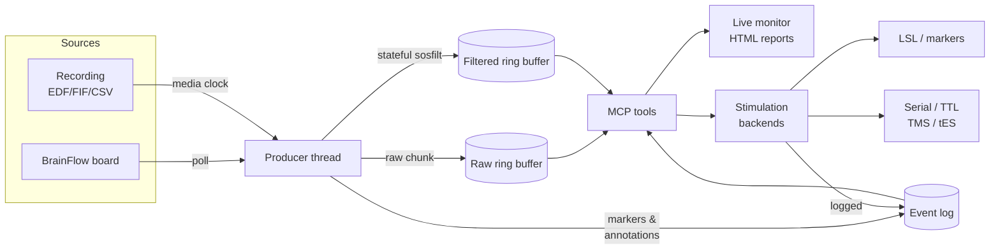

# eeg-mcp

**Real-time EEG over the Model Context Protocol.** Stream from hardware, replay
existing recordings against a wall clock, watch the signal live in a browser,
and dispatch stimulation events — all through one session model.

The offline counterpart is [neuro-mcp](https://github.com/AImplifier/neuro-mcp)
(MNE processing, source imaging, BIDS/EHR storage). This project is the
real-time half: everything that has to happen while the signal is still arriving.

---

## What it does

<div class="grid cards" markdown>

- **Stream**

    Any of 66 BrainFlow board identifiers, plus a synthetic board that needs no
    hardware. Samples land in a ring buffer filled by a background thread, so
    tool calls read a live view instead of blocking on a device.

- **Replay**

    Play an EDF/BDF/GDF/SET/FIF or BrainFlow CSV *at the rate it was recorded*,
    re-emitting its annotations as events at their original timings. The session
    behaves exactly like a live stream, so a pipeline developed against a file
    runs unchanged against hardware.

- **Visualize**

    A loopback-bound, token-gated live browser view with rolling traces, event
    markers, band power and per-channel quality — plus self-contained HTML
    reports that open on any machine with no internet.

- **Stimulate**

    One `send_stim_event` contract over pluggable backends: LSL for software,
    BrainFlow's marker channel for sample-aligned embedding, and serial/TTL or
    templated ASCII protocols for hardware including TMS and tES.

</div>

---

## Architecture



Everything downstream of the producer is written once against one interface, so
a live board and a replayed file are interchangeable.

---

## The one design decision worth knowing

**Filtering happens in the producer thread, not at query time.**

A stateful IIR filter must see every sample exactly once, in order. The common
shortcut — filtering each query window independently — restarts the filter at
every window boundary and injects a transient each time. It is invisible in a
band-power plot and fatal for anything phase-sensitive.

So the producer filters each chunk once as it arrives, carrying `sosfilt` delay-
line state forward, and writes the result to a second ring buffer. Queries just
read. The test suite asserts that chunked filtering matches whole-signal
filtering to `1e-9`, **and** asserts as a control that the naive approach does not.

!!! warning "Filters are causal"
    There is no zero-phase option, because that needs future samples. Check
    `group_delay_sec` from `stream_status` to know how far behind real time your
    filtered features are. Budget a closed loop as
    **group delay + poll interval + dispatch latency** — measured at ~71 ms in
    the reference configuration.

---

## Quick start

No hardware required:

```text
start_stream(session_id="s1", board="synthetic")
set_filters(session_id="s1", bandpass_low=1, bandpass_high=40, notch_freq=50)
get_band_power(session_id="s1", seconds=2)
start_monitor(session_id="s1")
```

Then open the returned URL to watch it live.

→ Continue with the [installation guide](installation.md) and the
[first real-time session tutorial](examples/tutorial-first-realtime-session.md).

---

!!! danger "Research use only"
    eeg-mcp is **not a medical device** and has not been validated for clinical
    use. Stimulation hardware — especially TMS and tES — can cause harm,
    including seizure. Read the [safety page](safety.md) before connecting
    anything to a person.
