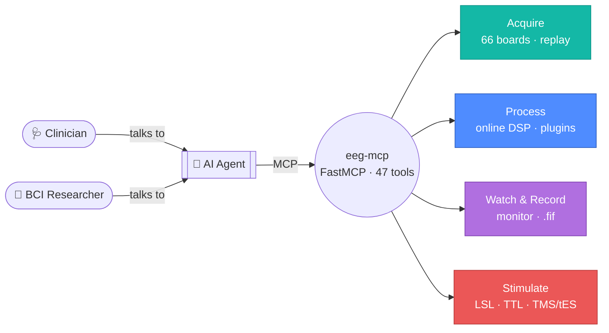
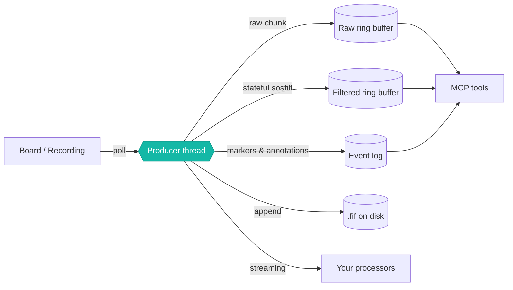

# eeg-mcp

<p style="font-size:1.15rem; line-height:1.6; margin-top:-.4rem">
<strong>Real-time EEG for AI agents.</strong> Stream from hardware, replay
recordings against a wall clock, watch the signal live, record it safely, and
dispatch stimulation — all through one session model.
</p>

[](https://pypi.org/project/eeg-mcp/)
[](https://pypi.org/project/eeg-mcp/)
[](https://registry.modelcontextprotocol.io/v0/servers?search=eeg-mcp)
[](https://github.com/AImplifier/eeg-mcp/blob/main/LICENSE)

[Get started :material-rocket-launch:](examples/tutorial-first-realtime-session.md){ .md-button .md-button--primary }
[Tool reference :material-tools:](tools/index.md){ .md-button }
[GitHub :material-github:](https://github.com/AImplifier/eeg-mcp){ .md-button }

```bash
pip install eeg-mcp
```

**47 tools over stdio.** The offline counterpart is
[neuro-mcp](https://github.com/AImplifier/neuro-mcp) (MNE processing, source
imaging, BIDS/EHR storage). This is the real-time half — everything that has to
happen while the signal is still arriving.

---

## What it does

<div class="grid cards" markdown>

-   :material-antenna:{ .lg .middle } **Stream**

    ---

    **66 BrainFlow board identifiers** — OpenBCI, Muse, ANT Neuro, g.tec,
    Mentalab — plus a synthetic board needing no hardware. A background thread
    fills a ring buffer, so tool calls read a live view instead of blocking on
    a device.

    [:octicons-arrow-right-24: Acquisition tools](tools/acquisition.md)

-   :material-rewind:{ .lg .middle } **Replay**

    ---

    Play an EDF/BDF/GDF/SET/FIF or BrainFlow CSV **at the rate it was
    recorded**, re-emitting annotations as events at their original timings.
    A pipeline built against a file runs *unchanged* against hardware.

    [:octicons-arrow-right-24: Replay-driven development](examples/replay-driven-development.md)

-   :material-chart-line:{ .lg .middle } **Process**

    ---

    Stateful online filtering that carries filter state across chunks, band
    power, PSD, and per-electrode quality — plus **your own processors**
    running inside the acquisition loop.

    [:octicons-arrow-right-24: Signal processing](tools/dsp.md)

-   :material-monitor-eye:{ .lg .middle } **Visualize**

    ---

    A loopback-bound, token-gated live browser view with rolling traces, event
    markers and transport controls. Self-contained HTML reports with **no CDN**
    — they open on an air-gapped machine.

    [:octicons-arrow-right-24: Visualization tools](tools/visualization.md)

-   :material-content-save:{ .lg .middle } **Record**

    ---

    Write continuously to MNE-native `.fif` with the event log attached as
    annotations, plus a metadata store an analysis tool can read directly.
    Crash-safe — an interrupted session is recoverable.

    [:octicons-arrow-right-24: Recording tools](tools/recording.md)

-   :material-flash:{ .lg .middle } **Stimulate**

    ---

    One `send_stim_event` contract over LSL, BrainFlow markers, serial/TTL, and
    templated protocols for **TMS and tES** — behind three safety gates.

    [:octicons-arrow-right-24: Safety first](safety.md)

</div>

!!! note "One event log, one clock"
    Board markers, replayed annotations, dispatched stimulations and manual
    notes all land in the same table with absolute sample indices. A closed-loop
    run reconstructs afterwards with **no clock join**.

---

## Concept



Nobody calls a tool by hand — you ask an agent for an outcome in plain English
and it drives the tools underneath.

---

## Try it in 60 seconds

No hardware required.

```python
start_stream(session_id="s1", board="synthetic")
check_signal_quality(session_id="s1")          # before trusting anything
set_filters(session_id="s1", bandpass_low=1, bandpass_high=40, notch_freq=50)
get_band_power(session_id="s1", seconds=2)
start_monitor(session_id="s1")                 # → open the returned URL
```

[Full tutorial :material-arrow-right:](examples/tutorial-first-realtime-session.md){ .md-button }

---

## The one design decision worth knowing

!!! important "Filtering happens in the producer thread, not at query time"

A stateful IIR filter must see every sample exactly once, in order. The common
shortcut — filtering each query window independently — restarts the filter at
every boundary and injects a transient each time. It is invisible in a
band-power plot and **fatal for anything phase-sensitive**.

So the producer filters each chunk once as it arrives, carrying `sosfilt`
delay-line state forward, and writes to a second ring buffer. Queries just read.



The test suite asserts chunked filtering matches whole-signal filtering to
**1e-9**, *and* asserts as a control that the naive approach does not.

| Consequence | |
|---|---|
| Filters are **causal** | No zero-phase option — that needs future samples. `stream_status` reports `group_delay_sec` |
| Both buffers are kept | `read_window(filtered=false)` always gets raw signal, to check whether a feature is real or an artifact |
| Indices are shared | An event's `sample_index` means the same thing in either buffer |

!!! tip "Budget your loop"
    **group delay + poll interval + dispatch latency** — measured at **~71 ms**
    in the reference configuration. Good for neurofeedback; *not* adequate for
    phase-locked stimulation.

---

## Where to go next

<div class="grid cards" markdown>

-   :material-download:{ .lg .middle } **[Installation](installation.md)**

    ---

    Environment, MCP client registration for Claude Code / Desktop / Codex,
    and troubleshooting.

-   :material-school:{ .lg .middle } **[Tutorial](examples/tutorial-first-realtime-session.md)**

    ---

    Eleven steps end to end, no hardware needed. Start here.

-   :material-puzzle:{ .lg .middle } **[Extending](extending.md)**

    ---

    Write a custom processor or an EEG tokenizer for sequence models.

-   :material-chip:{ .lg .middle } **[Supported hardware](hardware.md)**

    ---

    All 66 boards, replay formats, and stimulation transports.

-   :material-flask:{ .lg .middle } **[Examples](examples/index.md)**

    ---

    Closed-loop neurofeedback, clinical review, TMS/tES protocols.

-   :material-check-decagram:{ .lg .middle } **[Testing](testing.md)**

    ---

    254 checks — and an honest list of what is *not* covered.

</div>

---

!!! danger "Research use only"
    eeg-mcp is **not a medical device** and has not been validated for clinical
    use. Stimulation hardware — especially TMS and tES — can cause harm,
    including seizure.

    The hardware stimulation backends are **generic transports you configure
    from your device's manual, not vendor drivers**, and none has been tested
    against a physical stimulator. Read [Safety](safety.md) before connecting
    anything to a person.
