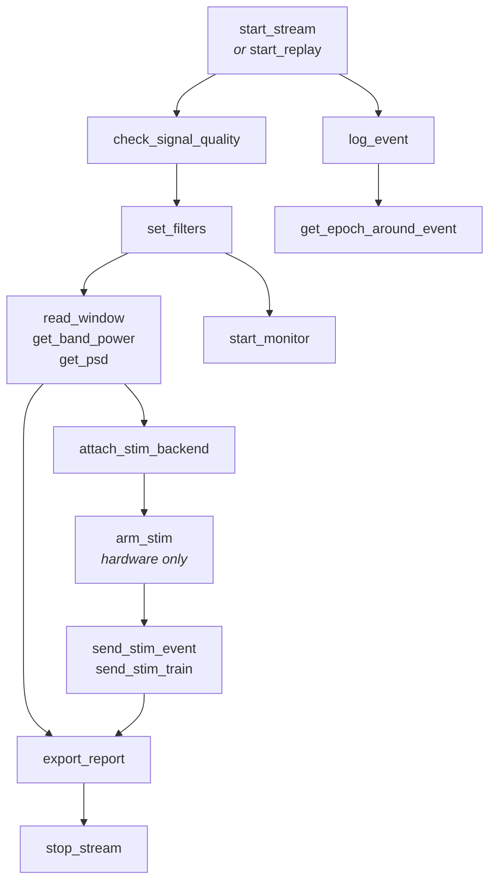

# Tool Reference

**47 tools** in eight groups. Every tool takes a `session_id` except
`list_boards`, `list_sessions`, `list_monitors`, `list_stim_backends`,
`list_processors`, `list_recordings`, `recover_recording`, and
`inspect_recording`.

## Call order



## Groups

| Group | Tools | Purpose |
|---|---|---|
| **[Acquisition](acquisition.md)** | `list_boards`, `start_stream`, `stop_stream`, `list_sessions`, `stream_status`, `read_window`, `get_channels` | Open a board, read the buffer |
| **[Replay](replay.md)** | `inspect_recording`, `start_replay`, `replay_control`, `list_recording_events` | Play a recording at wall-clock rate |
| **[Signal Processing](dsp.md)** | `set_filters`, `clear_filters`, `get_band_power`, `get_psd`, `check_signal_quality` | Filter online, compute features |
| **[Custom Processors](processing.md)** | `list_processors`, `attach_processor`, `detach_processor`, `processor_status`, `get_processor_output`, `run_processor`, `reset_processors`, `get_tokens` | Plug in your own real-time code |
| **[Recording](recording.md)** | `start_recording`, `stop_recording`, `recording_status`, `list_recordings`, `recover_recording` | Persist a session and register it |
| **[Events](events.md)** | `log_event`, `get_events`, `get_epoch_around_event`, `clear_events` | The unified event log |
| **[Visualization](visualization.md)** | `start_monitor`, `stop_monitor`, `list_monitors`, `plot_stream`, `plot_spectrum`, `export_report` | Live view and HTML output |
| **[Stimulation](stimulation.md)** | `list_stim_backends`, `attach_stim_backend`, `detach_stim_backend`, `arm_stim`, `disarm_stim`, `send_stim_event`, `send_stim_train`, `stim_status` | Dispatch events to software and hardware |

## Conventions

**Units.** All signal data is in **microvolts**, all timestamps are **Unix epoch
seconds**, all frequencies are **Hz**. MNE reads volts internally and the replay
source converts on load, so replayed and live amplitudes are directly comparable.

**Sessions.** A `session_id` is any string you choose. Live and replay sessions
are the same type of object and support the same tools; only
`replay_control` and `list_recording_events` require a replay.

**Filtered vs raw.** Tools that read signal take `filtered` (default `true`).
When no chain is set, they return raw and say so in the response. Raw is always
retained — `filtered=false` gets it back.

**Errors.** Failures raise with the offending value and the tool that fixes it:

```text
Unknown channels ['Xx9']. Available: Fp1, Fp2, Fz, Cz, Pz, C3, O1, O2
```

**Response size.** Tools returning sample arrays decimate to `max_samples` per
channel. For numeric work prefer `get_band_power` or `get_psd`, which compute on
full-resolution data and return summaries.
